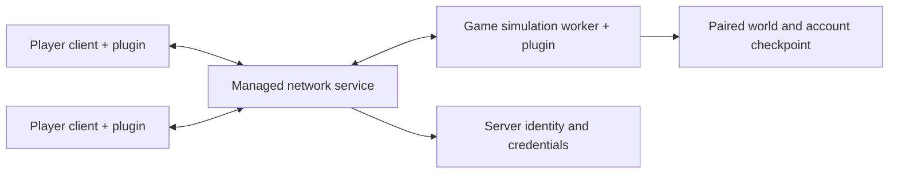

# Architecture

NivalisMP separates network sessions from native game simulation. The same plugin runs in a normal player client or in the dedicated Unity worker, selected by the worker launch arguments.

## Roles and authority

The **service** accepts connections, authenticates accounts, routes requests and distributes ordered world events. It maintains per-player delivery queues, receipts and scene membership. Chat routing is handled here. It does not replace the game's simulation.

The **worker** runs Nivalis Nights with the mod in an isolated world directory. It owns the native shared world, validates gameplay operations and captures replicated state. Account scopes temporarily select the requesting account's inventory/wallet at native interaction boundaries. Property and boat ownership are checked before mutation. Shop rental is currently broken in the alpha despite the presence of ownership infrastructure.

The **client** supplies local input, renders its own character and same-location peers, and applies authoritative updates to an isolated game view. Its map and apartment context can differ from another player's or the worker's currently loaded scene. Replicated NPC views do not run independent client AI to invent their own movement.

## Independent maps

`PlayerMapRuntime`, `PlayerSceneMembership`, `TravelReplication` and `ApartmentReplication` track each player's public map and private-property context. A player's transition updates that context without forcing peers to load the same map. `WorkerSceneResidency` loads native scenes as needed to execute authoritative interactions.

Each peer has its own bounded, ordered update queue. A loading client keeps its updates without holding up a different client's receipts. After native loading, controls remain locked behind the synchronization overlay until an ordered catch-up barrier has been applied and the service confirms a recent acknowledgement. Timeouts and bounds terminate failed catch-up rather than allowing interaction with incomplete state.

## Replication and performance

`DedicatedSession` coordinates the role-specific update loop. Replication modules handle NPCs, player poses, economy, businesses, crafting, dialogue, time/weather, property and boats.

Large snapshots can be decoded and prepared away from the Unity thread. Native application stays on that thread and is divided into bounded work. Verification and rollback protect individual native state changes. A single native call can still exceed the cooperative frame budget.

NPC playback buffers confirmed positions rather than extrapolating into unconfirmed movement. Worker movement guards cover selected public actions, and a resume correction rebases an ongoing walk when a native view is recreated. Explicit scheduled teleports and private transitions retain their native behavior. These mechanisms are not a guarantee that every NPC action or animation has been validated.

Boat state belongs to an account. Recall completion waits for the native berth operation, and arrival publishes authoritative destination state before travel completes. The client checks the current boat attachment before acknowledging arrival.

## Persistence and isolation

The native world snapshot and account ledger are committed as a pair. The ledger keeps persistent account assets and ownership separate from the shared simulation. A whole stopped-server backup must also retain credentials and server identity; restoring only one half of a checkpoint is unsafe.

Server worlds and multiplayer client views use isolated storage. Normal disconnect unloads that context and restores the client's personal save paths. New servers create a fresh sandbox instead of importing solo saves. Legacy shared assets, when migrating an older server world, are retained separately in escrow.

Shared sleep is a consensus operation. All connected players must report readiness at an allowed bed, then remain in the loading/recovery flow until the saved morning world is applied. Campaign quests and narrative debt are normalized away in multiplayer; native schedules, commerce and account accounting continue.

## Authentication and trust

The service keeps a persistent identity. Clients pin a trusted server fingerprint, and account login uses password proofs. Registration protects the transmitted verifier; the service does not need to store plaintext passwords. Gameplay transport is authenticated but not encrypted. See [SECURITY.md](../SECURITY.md) for the public deployment boundary and reporting guidance.

## Validation boundaries

Managed tests exercise protocol parsing, authentication, ownership policies, queues and state transitions. Native-interface checks cover expected signatures and hook wiring. Both are useful, but neither replaces live two-client testing or a measured performance capture.

The 0.5.2 alpha includes focused checks for its latest NPC and boat corrections. Its final combined native two-client/restart run and final one-client performance capture were not completed. Shop rental is not working yet and NPCs can behave irregularly. Public release status therefore remains purely an ALPHA.
